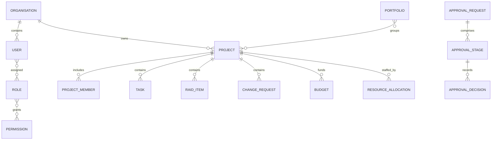

# PLANOVA Enterprise Product Requirements and Architecture Specification

**Document purpose:** Product, architecture, data, and delivery contract for a modular project, portfolio, resource, financial, workforce, and governance platform.

**Audience:** Product owners, enterprise architects, engineering teams, security reviewers, QA teams, implementation partners, and Codex.

**Status:** Build baseline 1.0  
**Date:** 7 October 2026  
**Product:** PLANOVA

---

## 1 Executive decision

PLANOVA will be one configurable enterprise platform. It will not contain five separate applications for Admin, Project Manager, Scrum Master, Team Member, and Governance. Those labels are initial role templates. Permissions, data scopes, project membership, delegated authority, and organisation policy determine what each user can see and do.

The initial technical form is a modular monolith with strict domain boundaries. It uses one authoritative record for each business object. Project, governance, portfolio, and personal pages are scoped views of the same records. Approval, audit, notification, document, comment, and attachment capabilities are shared platform services rather than implementations repeated inside each module.

The first release proves one core outcome: management, delivery teams, and governance can rely on one current view of project execution, risks, resources, budgets, and decisions. Timesheets, leave, advanced portfolio optimisation, release governance, custom workflow design, and AI assistance follow after the core data model is stable.

## 2 Product outcomes and measures

### 2.1 Outcomes

1. Replace fragmented project status reporting with authoritative project, milestone, RAID, change, decision, resource, and budget records.
2. Give users a relevant experience without duplicating applications or data by role.
3. Give governance an organisation-wide control view with traceable decisions and exceptions.
4. Enforce least privilege through capabilities and record scope.
5. Support Agile, Waterfall, Hybrid, and Operational work without imposing Scrum terminology on every project.
6. Add modules without weakening security, auditability, or domain ownership.

### 2.2 Initial success measures

| Measure | Initial target | Source |
|---|---:|---|
| Active projects with current health, manager, dates, and baseline | 95% | Project completeness report |
| Critical risks with owner, response, and next review date | 95% | RAID quality report |
| Decisions and approvals with full audit history | 100% | Approval and audit reports |
| Requests decided within configured service level | 90% | Approval metrics |
| Unauthorised cross-scope access in automated tests | 0 | Security test suite |
| Monthly active users who complete a core workflow | 70% after rollout | Product telemetry |
| Dashboard data freshness | Under 5 minutes for operational data | Observability metrics |

Targets are configurable deployment goals, not hard-coded product rules.

## 3 Scope

### 3.1 MVP 1

- Authentication and enterprise identity integration
- Organisation hierarchy, users, groups, role templates, permissions, and scopes
- Capability-aware navigation and composable dashboards
- Project core, membership, status, health, baselines, and activity
- Tasks, milestones, dependencies, comments, and attachments
- RAID records with escalation and review controls
- Change requests and the reusable approval engine
- Governance dashboard and enterprise queues over shared records
- People, capacity, project allocation, and utilisation
- Basic project budgets, categories, actuals, forecasts, and variance
- Administration, master data, audit search, notifications, exports, and essential reports

### 3.2 MVP 2

- Releases and release governance
- Timesheets and approvals
- Leave requests and team calendar
- Programs, advanced portfolios, strategic alignment, and scenario analysis
- Advanced resource forecasting and resource requests
- Advanced financial forecasting and billing reports
- Configurable workflow designer and policy rules
- External collaboration controls and extended integrations

### 3.3 Deferred

- Microservice decomposition without measured scaling or ownership need
- Autonomous project decisions
- AI Portfolio Copilot before data-quality controls are established
- Payroll, general ledger, full HRIS, procurement, source control, and document authoring replacement

## 4 Product principles

1. **One record with many authorised views.** A risk shown on a project page and in Governance is the same record and identifier.
2. **Capabilities before role names.** Code checks permissions and scope, never display labels such as `Project Manager`.
3. **Deny by default.** Every endpoint, command, query, export, dashboard widget, and background job applies authorisation.
4. **Server-side enforcement.** Hidden menus improve usability but never provide security.
5. **Domain ownership.** A module writes its own data. Other modules use contracts, queries, or events.
6. **Traceable control.** Material state, authority, approval, budget, and configuration changes produce immutable audit events.
7. **Configuration with guardrails.** Statuses, thresholds, templates, and workflows may be configured without allowing arbitrary code.
8. **Accessible and international-ready.** The interface meets WCAG 2.2 AA and separates display locale, time zone, and currency from stored values.

## 5 Personas and role templates

| Template | Typical responsibilities | Typical scope |
|---|---|---|
| Platform Administrator | Identity, roles, reference data, workflows, system configuration | Organisation, with sensitive functions separated |
| Project Manager | Project plan, team, health, RAID, changes, budget | Assigned projects |
| Scrum Master | Facilitation, board, impediments, delivery metrics | Assigned projects or teams |
| Team Member | Assigned work, updates, comments, risks, time and leave when enabled | Self and assigned records |
| Governance Analyst | Oversight, challenge, escalation, policy checks, reporting | Portfolio or organisation |
| Governance Approver | Decisions on changes, budgets, releases, exceptions | Assigned approval authority |
| Resource Manager | Capacity, allocation, resource requests | Department or resource pool |
| Finance Controller | Budgets, actuals, forecasts, financial approvals | Department, portfolio, or organisation |
| Executive Viewer | Portfolio health, strategic outcomes, top exceptions | Portfolio or organisation, read only |
| Auditor | Evidence and historical records | Organisation, read only, time bounded |

Corporate job title remains independent from PLANOVA access. A person may hold several PLANOVA roles, and assignments may be permanent, project-specific, delegated, or time bounded.

## 6 Information architecture and experience

### 6.1 Primary navigation

```text
Dashboard
Work
  Projects
  My Tasks
  Milestones
Portfolio
  Portfolio Overview
Governance
  Risks and Issues
  Changes
  Approvals
  Releases
Resources
  People
  Allocation
  Capacity
Financials
  Budgets
  Resource Cost
Workforce
  Timesheets
  Leave
Reports
Administration
```

A navigation item appears only when the user has at least one relevant read or action permission for an accessible record set. Direct URLs use the same policy and return `403` when the capability is absent and `404` when revealing record existence would disclose protected data.

### 6.2 Dashboard composition

Widgets declare a required permission, supported scopes, data query, refresh policy, empty state, and drill-through route. Users may reorder allowed widgets; administrators may define default layouts by role template. The server filters widget data before returning it.

| Experience | Default widgets |
|---|---|
| Team member | My Tasks, Upcoming Milestones, My Risks, Notifications, Timesheet and Leave when enabled |
| Project manager | Project Health, Team Workload, Milestones, RAID, Pending Decisions, Budget Variance |
| Governance | Portfolio Health, Critical Risks, Overdue Issues, Changes, Approval Queue, Compliance Exceptions |
| Executive | Investment, Strategic Alignment, Health Trend, Top Risks, Capacity, Major Milestones |
| Administrator | Access Exceptions, Failed Jobs, Integration Health, Configuration Changes, Audit Alerts |

Dashboard totals and drill-through results must use the same filters. An inaccessible count must never reveal hidden records.

## 7 Domain map and boundaries

| Domain | Owns | Does not own |
|---|---|---|
| Identity and Organisation | Users, groups, hierarchy, roles, permissions, assignments, delegations | Project membership, HR master employment record |
| Projects | Project identity, lifecycle, membership, baselines, health, project settings | Tasks, RAID, financial transactions |
| Work Management | Tasks, milestones, dependencies, comments, attachments | Project lifecycle and approval decisions |
| RAID | Risks, assumptions, issues, dependencies, responses, reviews | Governance copies of RAID records |
| Change and Approval | Change cases, workflow definitions, approval instances, decisions | Budget or release business fields |
| Governance | Policies, reviews, attestations, exceptions, oversight queries | Duplicate project, RAID, or change records |
| Resources | People profile projection, skills, capacity, allocations, resource requests | HR payroll or leave balances of record |
| Financials | Budgets, baselines, categories, actuals, forecasts, rates | General ledger entries of record |
| Workforce | Timesheets, time entries, leave requests, calendars | Payroll and HR benefits |
| Portfolio | Portfolios, programs, membership, objectives, scoring, snapshots | Project execution records |
| Release | Releases, gates, deployment windows, evidence | CI/CD execution |
| Platform Services | Audit, outbox, notifications, files, comments, subscriptions, integration jobs | Module business decisions |
| Reporting | Read models, saved reports, exports, metric definitions | Authoritative transactional data |

Cross-module references store stable IDs and optional display snapshots. Synchronous calls are limited to operations requiring an immediate invariant. Domain events update read models and trigger side effects. No module writes another module's tables.

## 8 Architecture baseline

- **Style:** modular monolith, feature-oriented modules, independently testable boundaries.
- **Suggested stack:** ASP.NET Core, Blazor Web App or an independently deployable web client, Entity Framework Core, PostgreSQL or SQL Server, OpenID Connect and Microsoft Entra ID for corporate deployment.
- **Structure:** each module contains Domain, Application, Infrastructure, API, Contracts, and Tests. Shared Kernel contains only primitives such as identifiers, clock, result, money, and tenancy context.
- **Data:** one database is acceptable initially. Use a schema per module and prohibit cross-schema writes. Reporting uses projections, replicas, or a warehouse as volume grows.
- **Consistency:** local ACID transactions inside a module. Use an outbox for events. Consumers are idempotent. Cross-module processes use state machines and compensating actions.
- **Caching:** permission-aware cache keys. Invalidate role, scope, and membership caches promptly. Never share cached result sets between security contexts.
- **Tenancy:** include `organisation_id` on tenant-owned records from the start. Every unique constraint that is tenant-specific includes it.

## 9 Identity RBAC and permission scopes

### 9.1 Permission model

A permission is a stable code in the form `resource.action`, for example `project.create`, `risk.close`, `change.approve`, or `role.manage`. A grant combines:

```text
principal + permission + scope type + scope reference + validity + conditions
```

Roles collect grants. Users receive roles directly, through groups, through project membership, or through a delegation. Explicit denies are reserved for exceptional policy and take precedence. Effective access is the union of valid grants minus valid denies.

### 9.2 Scope types

| Scope | Meaning |
|---|---|
| SELF | Records owned by or concerning the current user |
| ASSIGNED | Records assigned to the user |
| TEAM | Records for teams the user manages or belongs to, according to policy |
| PROJECT | A named project or projects reached through membership |
| DEPARTMENT | A department and optionally its descendants |
| PORTFOLIO | A portfolio and its contained programs and projects |
| ORGANISATION | All authorised tenant records |

Scope evaluation uses current hierarchy and membership, not client-submitted claims. A grant may contain an explicit `scope_ref_id`; organisation scope has none. Access decisions are logged for sensitive actions and denials are measurable without storing confidential payloads.

### 9.3 Core permission catalogue

| Area | Permissions |
|---|---|
| Projects | `project.view`, `project.create`, `project.edit`, `project.archive`, `project.manage_members`, `project.baseline`, `project.export` |
| Work | `task.view`, `task.create`, `task.edit`, `task.assign`, `task.delete`, `milestone.manage` |
| RAID | `raid.view`, `raid.create`, `raid.edit`, `raid.assign`, `raid.escalate`, `raid.close` |
| Change | `change.view`, `change.create`, `change.assess`, `change.submit`, `change.cancel` |
| Approval | `approval.view`, `approval.decide`, `approval.delegate`, `workflow.manage` |
| Governance | `governance.view`, `governance.review`, `exception.manage`, `policy.manage`, `attestation.manage` |
| Resources | `resource.view`, `resource.edit`, `allocation.view`, `allocation.manage`, `capacity.manage` |
| Financials | `budget.view`, `budget.edit`, `budget.baseline`, `actual.import`, `forecast.edit`, `financial.approve` |
| Workforce | `time.enter`, `time.view_team`, `time.approve`, `leave.request`, `leave.view_team`, `leave.approve` |
| Portfolio | `portfolio.view`, `portfolio.manage`, `portfolio.score`, `portfolio.snapshot` |
| Release | `release.view`, `release.manage`, `release.gate_decide` |
| Platform | `report.run`, `report.design`, `audit.view`, `audit.export`, `user.manage`, `role.manage`, `settings.manage`, `integration.manage` |

### 9.4 Authorisation acceptance criteria

- Every protected application command and query declares a permission and resolves scope on the server.
- List, search, count, export, autocomplete, notifications, and reports return only authorised records.
- Changing a user's assignment or role takes effect within five minutes and immediately for high-risk administrator actions.
- A user cannot approve their own request when separation-of-duties policy forbids it.
- Delegations have start and end times, are auditable, and cannot exceed the delegator's authority.
- Tests cover allowed and denied paths for each scope and prevent identifier enumeration.

## 10 Module requirements

### 10.1 Identity Organisation and Administration

**Scope.** Manage organisations, hierarchy, users, groups, role templates, permissions, assignments, delegations, reference data, feature flags, and security settings. Provisioning supports just-in-time login and SCIM later. Deactivation preserves historical attribution.

**Key rules.** User email and external subject are unique within the appropriate identity boundary. At least one active emergency administrator must remain. Privileged changes require recent authentication and audit. Role changes never rewrite historical decisions.

**Acceptance criteria.** An administrator can create a role from permissions and scoped grants; assign it with effective dates; preview effective access; revoke it; and see the change in audit history. A corporate job title has no automatic capability unless a mapping policy explicitly grants one.

### 10.2 Projects

**Scope.** Create and govern project identity, type, delivery method, ownership, manager, department, portfolio placement, dates, status, health, priority, progress, baselines, membership, and lifecycle.

**Key rules.** Project code is unique per organisation. End date is not before start date. Manager and sponsor are active users. Progress is derived from the configured method unless an authorised override includes a reason. Baselines are immutable versions. Archiving preserves related records.

**Acceptance criteria.** An authorised user can create a valid project, add members with project roles, submit a baseline, record health and rationale, and archive the project. The system rejects invalid dates, duplicate codes, inactive managers, and out-of-scope access. Each material change emits an audit event and a domain event.

### 10.3 Work Management

**Scope.** Tasks, milestones, assignments, dependencies, checklists, comments, attachments, activity, and list, board, and timeline views. Initial task states are Not Started, In Progress, Blocked, Completed, and Cancelled, but transitions are configurable.

**Key rules.** Dependencies cannot create a cycle. Completed work records completion time and actor. A milestone has zero duration and belongs to one project. Assignees must be active and allowed on the project unless an exception is approved. Deletion becomes soft deletion after activity exists.

**Acceptance criteria.** Users can create, assign, update, comment on, and complete work within scope; filter and paginate large work lists; see dependency and overdue indicators; and receive assignment and due-date notifications without duplicate delivery.

### 10.4 RAID

**Scope.** Risks, assumptions, issues, and cross-project dependencies with owners, probability, impact, severity, exposure, response, due dates, reviews, escalation, and closure evidence.

**Key rules.** Risk score derives from configured probability and impact matrices. Critical thresholds are organisation policies. Closure requires rationale; critical closure may require approval. An issue records impact and resolution. A converted risk retains a link to the resulting issue.

**Acceptance criteria.** A project user can record and manage RAID items; governance sees the same records across its scope; critical or overdue items appear in the correct queues; score changes retain history; and exports match the filtered authorised view.

### 10.5 Change Management and Approval Engine

**Scope.** Change requests capture reason, options, benefits, impact on scope, schedule, cost, resources, risk, and recommendation. The approval engine supports versioned workflows, serial or parallel stages, quorum, delegation, escalation, service levels, withdrawal, rejection, and rework.

**Key rules.** Submission freezes the reviewed payload version. A later edit creates a new version and may restart approval. Approval decisions are append-only. Workflow selection is deterministic and recorded. The request owner cannot decide where policy prohibits self-approval.

**Acceptance criteria.** An authorised user can draft, assess, submit, withdraw, and resubmit a change. Approvers see only assigned decisions and the exact submitted evidence. Parallel outcomes follow configured quorum. Completion updates the linked change state once, even if an event is retried.

### 10.6 Governance

**Scope.** Organisation and portfolio oversight, review cycles, policy checks, attestations, exceptions, decision queues, escalation, and evidence. Governance queries projects, RAID, changes, approvals, financials, resources, and releases through published read contracts.

**Key rules.** Governance does not create shadow copies of operational entities. A governance review may add findings, attestations, exceptions, and decisions linked to the source record. Snapshots record what reviewers saw at a point in time.

**Acceptance criteria.** A governance analyst can filter enterprise exceptions, open the source record, record a finding, request action, and close a review with evidence. Dashboard totals reconcile with detailed queues and respect the user's portfolio or organisation scope.

### 10.7 Resources

**Scope.** People projection, teams, skills, calendars, weekly capacity, project allocations, utilisation, resource requests, and warnings. HR remains the source for employment status where integrated.

**Key rules.** Capacity and allocation use dated periods. Allocation may be hours or percentage but is normalised for reporting. Over-allocation thresholds are configurable. Sensitive cost rates require separate permission. Historical allocations remain after deactivation.

**Acceptance criteria.** Resource managers can set capacity, allocate a person to projects, see remaining capacity and over-allocation, and approve or reject resource requests. Project managers see only permitted people and non-sensitive fields.

### 10.8 Financials

**Scope.** Project budgets, categories, versions, approved baselines, resource cost, actuals, commitments, forecasts, variance, thresholds, and approvals. Financial values store amount and ISO currency.

**Key rules.** Approved baselines are immutable. Adjustments use changes or authorised revisions. Actual imports are idempotent by source and external key. Exchange conversion stores rate, date, and source. Variance calculations have documented signs and periods.

**Acceptance criteria.** Finance can establish a baseline, import actuals without duplication, enter a forecast, view actual and forecast variance, and trigger threshold alerts. Users without cost permission see redacted totals or no widget according to policy.

### 10.9 Workforce

**Scope.** Timesheets, time entries, submission, approval, rejection, locking, leave requests, leave types, holidays, team calendar, and approval. This module is MVP 2 but uses the shared approval engine.

**Key rules.** Entries use local work date and duration, never floating timestamp alone. Submitted periods are versioned and locked after approval. Leave overlap and calendar rules are validated. HR may remain the leave balance authority.

**Acceptance criteria.** A user can enter and submit time; an authorised manager can decide it; locked entries cannot change without a controlled reopen. Leave visibility follows privacy policy and team calendars can hide the leave reason.

### 10.10 Portfolio and Programs

**Scope.** Portfolios, programs, membership, strategic objectives, investment themes, scoring models, prioritisation, benefits, scenario snapshots, and aggregated health.

**Key rules.** Operational metrics derive from source modules. Manual scores require rationale and history. Snapshots are immutable. A project may appear in more than one analytical portfolio only when configuration permits it.

**Acceptance criteria.** A portfolio owner can group projects, define weighted criteria, score and rank initiatives, inspect source metrics, and take a reproducible snapshot. Removing membership never deletes the project.

### 10.11 Release Governance

**Scope.** Release records, scope items, environments, gates, evidence, windows, dependencies, decisions, and post-release outcome. Delivery tools execute deployments; PLANOVA controls governance evidence.

**Key rules.** Gate decisions are append-only. Required evidence and approver groups depend on release type and risk. Emergency paths require reason and retrospective review.

**Acceptance criteria.** A release owner can assemble evidence, submit gates, receive decisions, and record outcome. A release cannot reach Approved while a required gate is incomplete.

### 10.12 Reporting and Platform Services

**Scope.** Saved reports, governed metrics, exports, subscriptions, files, comments, notifications, audit, outbox, integration jobs, retention, and operational health.

**Key rules.** Exports repeat authorisation at execution time, are encrypted, expire, and are audited. File access uses short-lived signed URLs and malware scanning. Notifications are preferences plus mandatory policy notices. Audit records are append-only and access controlled.

**Acceptance criteria.** A user can run a permitted report and export only authorised rows. Event retries do not duplicate notifications. Audit search returns actor, action, entity, correlation ID, before/after change summary, and timestamp without exposing protected secrets.

## 11 Shared workflow state models

| Object | States |
|---|---|
| Project | Draft, Proposed, Active, On Hold, Completed, Cancelled, Archived |
| Task | Not Started, In Progress, Blocked, Completed, Cancelled |
| RAID | Draft, Open, Monitoring, Escalated, Resolved, Closed |
| Change | Draft, Assessing, Ready for Approval, In Approval, Approved, Rejected, Withdrawn, Implemented, Closed |
| Approval | Pending, In Progress, Approved, Rejected, Withdrawn, Expired, Cancelled |
| Budget version | Draft, Submitted, Approved, Superseded, Rejected |
| Release | Draft, Planned, In Review, Approved, In Progress, Completed, Failed, Cancelled |

Transitions are explicit commands. The application rejects arbitrary state updates and records actor, reason, timestamp, and version.

## 12 Audit event and notification architecture

### 12.1 Audit

Audit is separate from application activity. Activity is user-facing collaboration; audit is immutable evidence. Each audit record contains organisation, actor or service identity, effective principal, action, entity type and ID, project if applicable, timestamp in UTC, correlation and causation IDs, client and source metadata, outcome, reason, and a redacted structured change set. Secrets, tokens, full file content, and prohibited personal data are never recorded.

Audit writes occur in the same transaction as the business change where feasible. Retention and legal hold are policy driven. Audit export is a separately privileged and audited action. Database operators cannot alter audit evidence without detection; production should use append-only storage or cryptographic integrity controls.

### 12.2 Events and notifications

Modules write business changes and outbox messages atomically. A dispatcher publishes versioned events such as `TaskAssigned.v1`, `RiskEscalated.v1`, `ApprovalRequested.v1`, `BudgetThresholdExceeded.v1`, and `ReleaseApproved.v1`. Consumers store processed message IDs.

The notification service resolves recipients, policy, preference, template, locale, and channel. It supports in-app and email first, then Teams and mobile push. Mandatory security and approval notices cannot be disabled. Digest, quiet hours, escalation, retry, dead-letter, and delivery status are explicit. Templates never receive data beyond the recipient's current access.

## 13 Data architecture standards

### 13.1 Conventions

- UUID or sortable UUID primary keys named `id`.
- Tenant-owned tables include `organisation_id` and an index beginning with it.
- Mutable aggregate roots include `row_version`, `created_at`, `created_by`, `updated_at`, and `updated_by`.
- Soft-deletable records include `deleted_at` and `deleted_by`; unique indexes exclude deleted rows where supported.
- Time is stored in UTC; local business dates use a date type; organisation and user time zones use IANA identifiers.
- Money uses `decimal(19,4)` plus `currency_code char(3)`. Percentages use documented precision.
- Status codes use constrained strings or reference tables, not database-specific enums when customer configuration is expected.
- JSON is reserved for versioned payloads, snapshots, and provider metadata. Query-critical fields remain relational.
- Foreign keys are enforced inside a module. Cross-module IDs are validated through contracts and reconciled asynchronously.
- Every list query has deterministic ordering, cursor pagination for high volume, and supporting composite indexes.

### 13.2 Relationship overview



## 14 Database catalogue

The catalogue specifies the minimum logical schema. Codex must produce provider-specific migrations, constraints, indexes, and row-level query filters. Fields marked FK reference the named table. Common audit columns from section 13 apply unless the table is immutable or append-only.

### 14.1 Identity and Organisation schema `identity`

| Table | Essential columns | Keys and relationships |
|---|---|---|
| `organisations` | `id`, `code`, `name`, `status`, `default_timezone`, `default_currency` | PK `id`; UQ `code` |
| `organisation_units` | `id`, `organisation_id`, `parent_id`, `type`, `code`, `name`, `path`, `status` | FK organisation; self FK parent; UQ organisation plus code; index path |
| `users` | `id`, `organisation_id`, `external_subject`, `email`, `display_name`, `job_title`, `timezone`, `locale`, `status`, `last_login_at` | FK organisation; UQ organisation plus external subject; filtered UQ email |
| `groups` | `id`, `organisation_id`, `external_key`, `name`, `type`, `status` | FK organisation; UQ external key |
| `group_members` | `group_id`, `user_id`, `valid_from`, `valid_to`, `source` | Composite PK; FKs group and user |
| `roles` | `id`, `organisation_id`, `code`, `name`, `description`, `is_system`, `status` | FK organisation; UQ organisation plus code |
| `permissions` | `id`, `code`, `resource`, `action`, `description`, `risk_level` | UQ code; platform catalogue |
| `role_grants` | `id`, `role_id`, `permission_id`, `effect`, `scope_type`, `scope_ref_id`, `conditions_json` | FKs role and permission; UQ effective grant tuple |
| `principal_role_assignments` | `id`, `organisation_id`, `principal_type`, `principal_id`, `role_id`, `scope_type`, `scope_ref_id`, `valid_from`, `valid_to`, `assigned_by`, `reason` | FK role; indexes principal and validity |
| `delegations` | `id`, `organisation_id`, `delegator_user_id`, `delegate_user_id`, `permission_filter_json`, `scope_type`, `scope_ref_id`, `starts_at`, `ends_at`, `status` | FKs users; check end after start |
| `access_policies` | `id`, `organisation_id`, `code`, `version`, `rule_json`, `status`, `effective_at` | UQ organisation, code, version |
| `reference_sets` | `id`, `organisation_id`, `code`, `name`, `module`, `status` | UQ organisation plus code |
| `reference_values` | `id`, `reference_set_id`, `code`, `label`, `sort_order`, `metadata_json`, `active_from`, `active_to` | FK set; UQ set plus code |

### 14.2 Projects schema `projects`

| Table | Essential columns | Keys and relationships |
|---|---|---|
| `projects` | `id`, `organisation_id`, `code`, `name`, `description`, `unit_id`, `portfolio_id`, `sponsor_user_id`, `manager_user_id`, `project_type`, `delivery_method`, `priority`, `status`, `health`, `start_date`, `target_end_date`, `actual_end_date`, `progress_pct`, `currency_code` | UQ organisation plus code; cross-module IDs indexed |
| `project_members` | `id`, `project_id`, `user_id`, `project_role_code`, `allocation_role`, `starts_on`, `ends_on`, `status` | FK project; UQ project, user, role, start |
| `project_status_history` | `id`, `project_id`, `from_status`, `to_status`, `reason`, `changed_at`, `changed_by` | FK project; append-only |
| `project_health_updates` | `id`, `project_id`, `health`, `summary`, `schedule_health`, `cost_health`, `scope_health`, `resource_health`, `effective_date`, `submitted_by` | FK project; index effective date |
| `project_baselines` | `id`, `project_id`, `version_no`, `name`, `scope_summary`, `start_date`, `end_date`, `budget_amount`, `currency_code`, `snapshot_json`, `approved_approval_id`, `status` | FK project; UQ project plus version |
| `project_settings` | `project_id`, `task_workflow_code`, `risk_matrix_id`, `calendar_id`, `progress_method`, `settings_json` | PK and FK project |
| `project_tags` | `project_id`, `tag_id` | Composite PK; FK project |

### 14.3 Work Management schema `work`

| Table | Essential columns | Keys and relationships |
|---|---|---|
| `tasks` | `id`, `organisation_id`, `project_id`, `parent_task_id`, `code`, `title`, `description`, `type`, `status`, `priority`, `start_date`, `due_date`, `completed_at`, `estimate_minutes`, `remaining_minutes`, `progress_pct`, `sort_key` | FK project concept; self FK parent; UQ project plus code |
| `task_assignments` | `id`, `task_id`, `user_id`, `assignment_type`, `assigned_at`, `unassigned_at` | FK task; index active user assignments |
| `task_dependencies` | `predecessor_task_id`, `successor_task_id`, `dependency_type`, `lag_minutes` | Composite PK; FKs tasks; check IDs differ; cycle check in domain |
| `task_checklist_items` | `id`, `task_id`, `text`, `is_complete`, `completed_at`, `completed_by`, `sort_order` | FK task |
| `milestones` | `id`, `organisation_id`, `project_id`, `name`, `description`, `target_date`, `actual_date`, `status`, `owner_user_id`, `is_key`, `baseline_date` | FK project concept; index target date and status |
| `comments` | `id`, `organisation_id`, `entity_type`, `entity_id`, `author_user_id`, `body`, `parent_comment_id`, `edited_at` | Polymorphic contract; self FK; index entity |
| `attachments` | `id`, `organisation_id`, `entity_type`, `entity_id`, `file_id`, `title`, `classification`, `uploaded_by` | FK platform file by contract; index entity |

### 14.4 RAID schema `raid`

| Table | Essential columns | Keys and relationships |
|---|---|---|
| `raid_items` | `id`, `organisation_id`, `project_id`, `code`, `type`, `title`, `description`, `status`, `owner_user_id`, `raised_by`, `raised_at`, `due_date`, `review_date`, `probability`, `impact`, `score`, `severity`, `escalation_level`, `source_item_id`, `closed_at`, `closure_reason` | UQ project plus code; self link for conversion; indexes type, status, score |
| `raid_responses` | `id`, `raid_item_id`, `response_type`, `description`, `owner_user_id`, `due_date`, `status`, `effectiveness` | FK RAID item |
| `raid_reviews` | `id`, `raid_item_id`, `reviewed_at`, `reviewed_by`, `probability`, `impact`, `score`, `status`, `comment` | FK item; append-only |
| `risk_matrices` | `id`, `organisation_id`, `name`, `version`, `status`, `effective_from` | UQ organisation, name, version |
| `risk_matrix_cells` | `matrix_id`, `probability_value`, `impact_value`, `score`, `rating`, `colour_token` | Composite PK; FK matrix |

### 14.5 Change and Approval schema `approval`

| Table | Essential columns | Keys and relationships |
|---|---|---|
| `change_requests` | `id`, `organisation_id`, `project_id`, `code`, `title`, `reason`, `description`, `option_summary`, `scope_impact`, `schedule_impact_days`, `cost_impact_amount`, `currency_code`, `resource_impact`, `risk_impact`, `recommendation`, `owner_user_id`, `status`, `current_version` | UQ project plus code |
| `change_versions` | `id`, `change_request_id`, `version_no`, `payload_json`, `created_by`, `created_at`, `content_hash` | FK change; UQ change plus version; immutable |
| `workflow_definitions` | `id`, `organisation_id`, `code`, `name`, `entity_type`, `version`, `selection_rule_json`, `status`, `effective_from` | UQ organisation, code, version |
| `workflow_stages` | `id`, `workflow_definition_id`, `stage_no`, `name`, `mode`, `quorum_type`, `quorum_value`, `due_after_minutes`, `approver_rule_json` | FK workflow; UQ workflow plus stage number |
| `approval_requests` | `id`, `organisation_id`, `entity_type`, `entity_id`, `entity_version`, `workflow_definition_id`, `requested_by`, `requested_at`, `status`, `current_stage_no`, `payload_hash`, `completed_at` | FK workflow; UQ active entity/version where applicable |
| `approval_stage_instances` | `id`, `approval_request_id`, `workflow_stage_id`, `stage_no`, `status`, `started_at`, `due_at`, `completed_at` | FKs request and stage |
| `approval_assignments` | `id`, `stage_instance_id`, `approver_user_id`, `approver_group_id`, `source`, `status` | FK stage; one approver target required |
| `approval_decisions` | `id`, `stage_instance_id`, `assignment_id`, `decision`, `comment`, `decided_by`, `decided_at`, `on_behalf_of`, `evidence_file_id` | FKs stage and assignment; append-only; UQ assignment decision |
| `approval_escalations` | `id`, `stage_instance_id`, `level`, `triggered_at`, `recipient_json`, `status` | FK stage; idempotency key |

### 14.6 Governance schema `governance`

| Table | Essential columns | Keys and relationships |
|---|---|---|
| `governance_reviews` | `id`, `organisation_id`, `scope_type`, `scope_ref_id`, `review_type`, `period_start`, `period_end`, `status`, `chair_user_id`, `snapshot_id` | Index scope and period |
| `review_items` | `id`, `review_id`, `entity_type`, `entity_id`, `entity_version`, `agenda_order`, `outcome`, `notes` | FK review; UQ review and entity |
| `governance_findings` | `id`, `organisation_id`, `review_id`, `entity_type`, `entity_id`, `category`, `severity`, `description`, `owner_user_id`, `due_date`, `status`, `closed_at` | FK review; indexes owner, due, status |
| `policies` | `id`, `organisation_id`, `code`, `name`, `version`, `policy_type`, `rule_json`, `effective_from`, `effective_to`, `status` | UQ organisation, code, version |
| `attestations` | `id`, `organisation_id`, `policy_id`, `entity_type`, `entity_id`, `attested_by`, `attested_at`, `result`, `evidence_file_id`, `expires_at` | FK policy; index entity |
| `exceptions` | `id`, `organisation_id`, `policy_id`, `entity_type`, `entity_id`, `reason`, `risk_summary`, `owner_user_id`, `status`, `valid_from`, `valid_to`, `approval_request_id` | FK policy; index expiry and status |
| `governance_snapshots` | `id`, `organisation_id`, `scope_type`, `scope_ref_id`, `as_of_at`, `payload_json`, `content_hash` | Immutable; index scope and time |

### 14.7 Resources schema `resources`

| Table | Essential columns | Keys and relationships |
|---|---|---|
| `people` | `id`, `organisation_id`, `user_id`, `employee_external_key`, `unit_id`, `manager_user_id`, `employment_status`, `fte`, `start_date`, `end_date`, `calendar_id` | UQ organisation plus external key; optional UQ user |
| `teams` | `id`, `organisation_id`, `code`, `name`, `manager_user_id`, `unit_id`, `status` | UQ organisation plus code |
| `team_members` | `team_id`, `person_id`, `starts_on`, `ends_on`, `role_code` | Composite logical key; FKs team and person |
| `skills` | `id`, `organisation_id`, `code`, `name`, `category`, `status` | UQ organisation plus code |
| `person_skills` | `person_id`, `skill_id`, `proficiency`, `verified_by`, `verified_at`, `expires_at` | Composite PK; FKs person and skill |
| `work_calendars` | `id`, `organisation_id`, `name`, `timezone`, `hours_per_week`, `status` | FK organisation |
| `calendar_exceptions` | `id`, `calendar_id`, `date`, `available_minutes`, `reason` | FK calendar; UQ calendar plus date |
| `capacity_periods` | `id`, `person_id`, `period_start`, `period_end`, `available_minutes`, `source` | FK person; prevent overlapping source periods |
| `resource_allocations` | `id`, `organisation_id`, `person_id`, `project_id`, `role_code`, `start_date`, `end_date`, `allocation_pct`, `planned_minutes`, `status` | FK person; index project and date range |
| `resource_requests` | `id`, `organisation_id`, `project_id`, `skill_id`, `role_code`, `start_date`, `end_date`, `requested_fte`, `priority`, `status`, `requested_by`, `fulfilled_person_id` | FKs skill and person; index status |

### 14.8 Financials schema `financials`

| Table | Essential columns | Keys and relationships |
|---|---|---|
| `budgets` | `id`, `organisation_id`, `project_id`, `name`, `fiscal_year`, `currency_code`, `status`, `current_version_id` | UQ project, fiscal year, name |
| `budget_categories` | `id`, `organisation_id`, `code`, `name`, `parent_id`, `type`, `status` | Self FK; UQ organisation plus code |
| `budget_versions` | `id`, `budget_id`, `version_no`, `status`, `total_amount`, `submitted_at`, `approved_at`, `approval_request_id` | FK budget; UQ budget plus version |
| `budget_lines` | `id`, `budget_version_id`, `category_id`, `period_start`, `period_end`, `description`, `quantity`, `unit_cost`, `amount`, `cost_type` | FKs version and category |
| `actual_costs` | `id`, `organisation_id`, `project_id`, `category_id`, `posting_date`, `period`, `amount`, `currency_code`, `base_amount`, `source_system`, `external_key`, `description` | UQ organisation, source, external key; indexes project and period |
| `commitments` | `id`, `organisation_id`, `project_id`, `category_id`, `reference`, `amount`, `currency_code`, `expected_date`, `status` | UQ source reference when imported |
| `forecasts` | `id`, `organisation_id`, `project_id`, `as_of_date`, `version_no`, `status`, `currency_code`, `approval_request_id` | UQ project, as-of date, version |
| `forecast_lines` | `id`, `forecast_id`, `category_id`, `period`, `amount`, `basis`, `note` | FKs forecast and category |
| `cost_rates` | `id`, `organisation_id`, `person_id`, `role_code`, `amount`, `currency_code`, `unit`, `effective_from`, `effective_to`, `classification` | Sensitive; date-range constraint |
| `exchange_rates` | `id`, `organisation_id`, `rate_date`, `from_currency`, `to_currency`, `rate`, `source` | UQ organisation, date, currency pair, source |

### 14.9 Workforce schema `workforce`

| Table | Essential columns | Keys and relationships |
|---|---|---|
| `timesheets` | `id`, `organisation_id`, `person_id`, `period_start`, `period_end`, `version_no`, `status`, `submitted_at`, `approval_request_id`, `locked_at` | UQ person, period, version |
| `time_entries` | `id`, `timesheet_id`, `work_date`, `project_id`, `task_id`, `minutes`, `billable`, `description` | FK timesheet; index project and date |
| `leave_types` | `id`, `organisation_id`, `code`, `name`, `privacy_level`, `approval_workflow_code`, `status` | UQ organisation plus code |
| `leave_requests` | `id`, `organisation_id`, `person_id`, `leave_type_id`, `start_at`, `end_at`, `duration_minutes`, `reason_private`, `status`, `approval_request_id` | FKs person and type; overlap validation |
| `holidays` | `id`, `calendar_id`, `date`, `name`, `duration_minutes` | UQ calendar plus date and name |

### 14.10 Portfolio schema `portfolio`

| Table | Essential columns | Keys and relationships |
|---|---|---|
| `portfolios` | `id`, `organisation_id`, `code`, `name`, `owner_user_id`, `description`, `status`, `currency_code` | UQ organisation plus code |
| `programs` | `id`, `organisation_id`, `portfolio_id`, `code`, `name`, `manager_user_id`, `status`, `start_date`, `end_date` | FK portfolio; UQ organisation plus code |
| `portfolio_projects` | `portfolio_id`, `project_id`, `program_id`, `joined_on`, `left_on`, `membership_type` | Composite logical key; indexes project |
| `strategic_objectives` | `id`, `organisation_id`, `code`, `name`, `description`, `owner_user_id`, `status` | UQ organisation plus code |
| `project_objectives` | `project_id`, `objective_id`, `contribution_pct`, `rationale` | Composite PK |
| `scoring_models` | `id`, `organisation_id`, `name`, `version`, `status` | UQ organisation, name, version |
| `scoring_criteria` | `id`, `model_id`, `code`, `name`, `weight`, `scale_json`, `sort_order` | FK model; UQ model plus code |
| `project_scores` | `id`, `project_id`, `model_id`, `criterion_id`, `score`, `rationale`, `scored_by`, `scored_at` | FKs model and criterion; history retained |
| `portfolio_snapshots` | `id`, `portfolio_id`, `as_of_at`, `scenario_name`, `payload_json`, `content_hash` | FK portfolio; immutable |

### 14.11 Release schema `release`

| Table | Essential columns | Keys and relationships |
|---|---|---|
| `releases` | `id`, `organisation_id`, `project_id`, `code`, `name`, `release_type`, `risk_level`, `status`, `planned_start`, `planned_end`, `actual_start`, `actual_end`, `owner_user_id` | UQ organisation plus code |
| `release_items` | `id`, `release_id`, `entity_type`, `entity_id`, `description`, `status` | FK release; UQ release and entity |
| `release_gates` | `id`, `release_id`, `gate_definition_id`, `sequence`, `status`, `approval_request_id`, `due_at` | FK release; UQ release and gate definition |
| `gate_definitions` | `id`, `organisation_id`, `code`, `name`, `required_evidence_json`, `workflow_code`, `status` | UQ organisation plus code |
| `release_evidence` | `id`, `release_id`, `gate_id`, `file_id`, `evidence_type`, `submitted_by`, `submitted_at` | FKs release and gate |
| `deployment_windows` | `id`, `organisation_id`, `environment`, `starts_at`, `ends_at`, `capacity`, `status` | Check end after start |

### 14.12 Platform and Reporting schemas `platform` and `reporting`

| Table | Essential columns | Keys and relationships |
|---|---|---|
| `audit_events` | `id`, `organisation_id`, `occurred_at`, `actor_type`, `actor_id`, `effective_user_id`, `action`, `entity_type`, `entity_id`, `project_id`, `outcome`, `reason`, `changes_json`, `correlation_id`, `causation_id`, `source` | Append-only; indexes entity, actor, project, time; partition by time at scale |
| `outbox_messages` | `id`, `organisation_id`, `occurred_at`, `event_type`, `event_version`, `aggregate_type`, `aggregate_id`, `payload_json`, `correlation_id`, `published_at`, `attempt_count`, `next_attempt_at` | Index unpublished and next attempt |
| `inbox_messages` | `consumer`, `message_id`, `received_at`, `processed_at`, `outcome` | Composite PK; idempotency |
| `files` | `id`, `organisation_id`, `storage_key`, `original_name`, `media_type`, `size_bytes`, `sha256`, `classification`, `scan_status`, `retention_until`, `uploaded_by` | UQ storage key; index hash and scan status |
| `notification_templates` | `id`, `organisation_id`, `code`, `channel`, `locale`, `version`, `subject_template`, `body_template`, `status` | UQ organisation, code, channel, locale, version |
| `notification_preferences` | `user_id`, `event_type`, `channel`, `enabled`, `digest_mode`, `quiet_hours_json` | Composite PK |
| `notifications` | `id`, `organisation_id`, `event_id`, `recipient_user_id`, `event_type`, `title`, `body_summary`, `entity_type`, `entity_id`, `read_at`, `expires_at` | UQ recipient plus event plus type |
| `notification_deliveries` | `id`, `notification_id`, `channel`, `destination_hash`, `status`, `attempt_count`, `last_attempt_at`, `provider_message_id`, `error_code` | FK notification; idempotency key |
| `subscriptions` | `id`, `organisation_id`, `user_id`, `entity_type`, `entity_id`, `event_filter_json`, `status` | UQ user and entity |
| `integration_connections` | `id`, `organisation_id`, `provider`, `name`, `status`, `secret_reference`, `settings_json`, `last_verified_at` | Secret reference only; UQ organisation plus name |
| `integration_jobs` | `id`, `connection_id`, `job_type`, `cursor`, `started_at`, `completed_at`, `status`, `statistics_json`, `error_summary` | FK connection; index status and start |
| `metric_definitions` | `id`, `organisation_id`, `code`, `name`, `description`, `formula_version`, `formula_json`, `unit`, `status` | UQ organisation, code, version |
| `saved_reports` | `id`, `organisation_id`, `owner_user_id`, `name`, `dataset_code`, `definition_json`, `visibility`, `status` | Index owner and dataset |
| `report_schedules` | `id`, `saved_report_id`, `schedule`, `recipient_rule_json`, `format`, `status`, `next_run_at` | FK report; index next run |
| `export_jobs` | `id`, `organisation_id`, `requested_by`, `report_id`, `filter_json`, `format`, `status`, `file_id`, `expires_at` | Index requester and status |

## 15 API and integration principles

### 15.1 API contract

- REST endpoints use `/api/v1/{resource}` and plural nouns. Commands that represent business transitions use explicit subresources such as `/changes/{id}/submit`.
- OpenAPI is generated and validated in CI. Breaking changes require a new major version or a compatible migration window.
- Requests use idempotency keys for create, submit, import, and external callback operations.
- Updates use optimistic concurrency through ETags or `rowVersion`; conflicts return `409` with a safe comparison.
- Errors follow RFC 9457 Problem Details and include stable code, correlation ID, field errors, and safe message.
- List endpoints use filters, stable sort, field selection where safe, and cursor pagination. Maximum page sizes are enforced.
- Date-time values use ISO 8601 with offset at boundaries and UTC internally. Money is an object containing amount and currency.
- Bulk operations are asynchronous jobs with progress, partial error reports, cancellation where safe, and audit.

### 15.2 Integration design

Identity uses OpenID Connect first and SCIM later. HRIS supplies worker and organisation projections. ERP supplies actuals and may receive approved budgets. Collaboration channels receive notifications. Calendar integration publishes milestones and approved leave. Document repositories may store governed documents while PLANOVA retains metadata and access references.

Connections use least-privilege service identities and a secrets manager. Webhooks are signed, timestamped, replay protected, versioned, retried, and observable. Imports stage and validate data before commit, retain source keys, and return row-level errors. Each integration has an owner, data contract, service objective, reconciliation process, and disable switch.

## 16 Non functional requirements

| Category | Requirement |
|---|---|
| Availability | 99.9% monthly for production excluding announced maintenance; graceful degradation for optional channels and analytics |
| Performance | P95 reads under 500 ms and writes under 800 ms at agreed reference load; dashboard shell under 2 seconds; expensive exports asynchronous |
| Scale | Initial design supports 10,000 users, 2,000 active projects, 2 million tasks, and 50 million audit events per organisation through indexing and partitioning; validate actual targets before production |
| Security | OIDC, MFA policy from identity provider, least privilege, OWASP ASVS Level 2 baseline, rate limits, secure headers, CSRF protection, dependency and secret scanning |
| Privacy | Data minimisation, field classification, purpose-based access, retention, subject request support, residency configuration, redacted logs |
| Encryption | TLS 1.2 or later in transit; managed encryption at rest; customer-specific keys when required; secrets never stored in application tables |
| Audit | Immutable material event history, UTC time, actor attribution, correlation, export control, retention and legal hold |
| Recovery | Target RPO 15 minutes and RTO 4 hours for production; encrypted backups and quarterly restore tests |
| Accessibility | WCAG 2.2 AA, keyboard operation, visible focus, screen-reader labels, non-colour status cues, accessible tables and charts |
| Compatibility | Current and previous major versions of Edge, Chrome, Firefox, and Safari; responsive desktop and tablet layouts |
| Localisation | Externalised strings, locale formats, IANA time zones, ISO currencies, right-to-left readiness; English first |
| Observability | Structured logs, traces, metrics, health checks, business process metrics, correlation IDs, alert runbooks; no confidential payloads |
| Maintainability | Module boundary tests, architecture decision records, automated migrations, code ownership, 80% coverage goal for domain/application logic with risk-based exceptions |
| Data quality | Required-field, referential, range, transition, duplicate, and reconciliation checks; quality dashboards for governed fields |

## 17 Testing and release gates

Each feature includes unit tests for rules, application tests for permissions and scope, integration tests for persistence and events, contract tests for APIs, and end-to-end tests for critical journeys. Security testing covers privilege escalation, insecure direct object references, export leakage, workflow bypass, mass assignment, and audit tampering. Performance tests use realistic tenant and history volumes.

A release cannot proceed unless migrations are backward compatible for the deployment window, rollback or forward-fix is documented, accessibility checks pass, high-severity security findings are resolved, observability is present, and product acceptance criteria are demonstrated with seeded data.

## 18 Implementation order

| Phase | Deliverable | Exit gate |
|---:|---|---|
| 0 | Repository, architecture decisions, CI, design system, database conventions, auth shell, observability, audit and outbox foundations | Reference vertical slice deploys and is observable |
| 1 | Identity, organisation, RBAC, scope evaluator, navigation and admin | Permission matrix and negative security tests pass |
| 2 | Project core, membership, status, health and baselines | Project lifecycle and audit accepted |
| 3 | Tasks, milestones, dependencies, comments and files | Project team can run a basic plan |
| 4 | RAID and governance read queues | Same RAID record reconciles across project and governance views |
| 5 | Change requests and reusable approval engine | Versioned multi-stage approval passes concurrency and retry tests |
| 6 | Governance reviews, findings, policies and exceptions | Oversight workflow and evidence accepted |
| 7 | Resources, capacity, allocations and requests | Capacity and over-allocation calculations verified |
| 8 | Budgets, actuals, forecasts and variance | Baseline immutability and import idempotency verified |
| 9 | Notifications, reporting hardening, operational dashboards and MVP 1 rollout | NFR, security, accessibility, recovery, and UAT gates pass |
| 10 | Timesheets and leave | Workforce privacy and approvals accepted |
| 11 | Portfolio, programs, scoring and executive reporting | Metrics reconcile to source modules |
| 12 | Release governance and advanced integrations | Gate and integration recovery tests pass |

Do not build executive analytics before source records and metric definitions are stable. Do not split a module into a service until monitoring shows an independent scaling, reliability, deployment, or ownership need.

## 19 Codex execution contract

### 19.1 Repository documents

Store this file at `/docs/PLANOVA_Enterprise_PRD.md`. Add:

- `/docs/architecture/architecture-constitution.md`
- `/docs/architecture/domain-boundaries.md`
- `/docs/architecture/decisions/ADR-NNN-title.md`
- `/docs/security/permission-catalogue.md`
- `/docs/data/data-dictionary.md`
- `/docs/api/openapi.yaml`
- `/docs/testing/test-strategy.md`
- `/docs/operations/runbooks/`

Codex must read the PRD, constitution, relevant ADRs, and module documents before changing code.

### 19.2 Required prompt for every feature

```text
FEATURE
<one user-visible capability>

BUSINESS OUTCOME
<observable outcome>

ACTORS AND SCOPE
<permissions, allowed scopes, separation-of-duties rules>

IN SCOPE
<explicit list>

OUT OF SCOPE
<explicit list>

DOMAIN RULES
<invariants and state transitions>

DATA CHANGES
<tables, fields, relationships, retention, migration and seed impact>

API CONTRACT
<requests, responses, errors, concurrency and idempotency>

UI BEHAVIOUR
<routes, states, validation, accessibility, empty and error states>

EVENTS AUDIT AND NOTIFICATIONS
<events and versions, audit actions, recipients and retry behavior>

ACCEPTANCE CRITERIA
Given <context>
When <action>
Then <observable result>

NON FUNCTIONAL AND TEST REQUIREMENTS
<security, performance, privacy, accessibility, unit, integration and E2E tests>
```

### 19.3 Codex work sequence

For each feature, Codex must:

1. Inspect the repository, current migrations, module contracts, tests, and local instructions.
2. State assumptions and identify any conflict with this PRD. Stop for a product decision when a conflict changes data ownership, security, or workflow meaning.
3. Propose the smallest vertical slice and list affected modules. Avoid speculative abstractions.
4. Define or update domain rules, permission checks, data migration, API contract, UI states, events, audit, and tests before implementation.
5. Implement inside the owning module. Use public contracts or events for other modules.
6. Add safe forward migration and representative seed or fixture data. Never rewrite an applied production migration.
7. Test allowed and denied access, scope boundaries, validation, concurrency, idempotency, audit, event retry, and accessibility.
8. Run formatting, build, tests, architecture checks, migration validation, and secret/dependency scans.
9. Report changed files, migration and deployment notes, test evidence, remaining risks, and any deliberate deviation.
10. Update relevant documentation and ADRs in the same change.

### 19.4 Rules Codex must not violate

- Do not use role-name checks in business or UI code.
- Do not trust organisation, user, permission, scope, price, status, or approval outcome supplied by the client.
- Do not create governance copies of project, RAID, change, approval, resource, or financial records.
- Do not write another module's tables or share mutable domain entities across modules.
- Do not send email or Teams messages from domain handlers; emit an event.
- Do not log secrets, tokens, full approval evidence, private leave reasons, or unrestricted before/after payloads.
- Do not bypass an aggregate transition with a generic update endpoint.
- Do not add a JSON field when a relational field is required for rules, filtering, joining, uniqueness, or reporting.
- Do not introduce a microservice, message broker, or new infrastructure product without an ADR and measured need.
- Do not mark work complete without tests and acceptance evidence.

### 19.5 Definition of done

A feature is complete when product acceptance criteria pass; authorisation is enforced at API and query levels; schema and migration are reviewed; audit and event behavior are verified; notifications are idempotent; UI covers loading, empty, error, forbidden, and conflict states; accessibility checks pass; telemetry and support guidance exist; documentation is current; and CI is green.

## 20 Sample first implementation brief

```text
FEATURE
Create project

BUSINESS OUTCOME
An authorised manager creates a governed project record that can receive members and work.

ACTORS AND SCOPE
Requires project.create. The selected organisation unit must be within the grant scope.

IN SCOPE
Form, validation, POST endpoint, project aggregate, migration, audit event,
ProjectCreated.v1 event, confirmation page, tests.

OUT OF SCOPE
Tasks, RAID, budgets, approvals, imports, portfolio scoring.

DOMAIN RULES
Code is unique per organisation. End date is on or after start date.
Manager and sponsor are active users visible within policy. Initial state is Draft.

ACCEPTANCE CRITERIA
Given a user with project.create for Department A
When the user submits valid Department A project data
Then PLANOVA creates one Draft project, records PROJECT_CREATED, publishes
ProjectCreated.v1 through the outbox, and returns 201 with its location.

Given the same user
When the user selects Department B outside the grant scope
Then PLANOVA returns a safe forbidden response and creates no project or event.

Given an existing project code in the organisation
When another create request uses that code
Then PLANOVA returns a field-level conflict and creates no duplicate.
```

## 21 Product decisions required before production

The product owner and enterprise stakeholders must approve the production deployment profile: database provider; hosting region and residency; target concurrency and data volumes; identity and HR sources; fiscal calendar; base and reporting currencies; retention and legal hold; project and approval policies; segregation-of-duties matrix; RPO and RTO; notification channels; accessibility test process; and which MVP 2 modules are licensed or enabled.

These choices configure the architecture. They do not change the core decisions in this specification.

